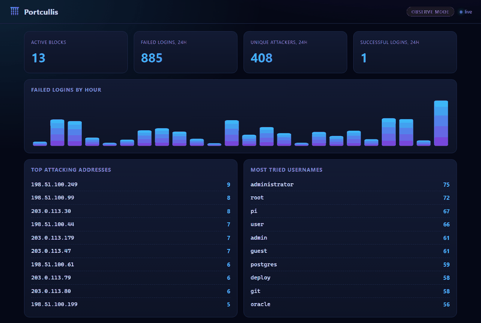

# Portcullis

**fail2ban with a dashboard, for Windows RDP and Linux SSH. About a minute to install, no dependencies.**

[](https://github.com/BASIL-SAJI-MATHEW/portcullis/actions/workflows/ci.yml)
[](LICENSE)


Any server with port 3389 (RDP) or 22 (SSH) open to the internet is attacked within minutes by bots
guessing passwords. Portcullis watches your login logs, spots the attackers, blocks them in the
firewall, tells you on Discord, Telegram or Slack, and shows everything on a clean web dashboard.



## Why another tool?

Linux has `fail2ban`, which is excellent but is configured with filter files and has no dashboard.
On Windows the free options are thin, and people leave RDP exposed with nothing watching it.
Portcullis aims to be the simple, friendly option for one or a few servers:

- **One tool for both** Windows RDP and Linux SSH, with the same dashboard and the same alerts.
- **Starts in observe mode.** It tells you who it would block and blocks nothing until you say so, so
  it cannot lock you out on day one.
- **No dependencies.** Pure Python standard library, so installing it is `pipx install` and nothing
  else can break or be hijacked in the supply chain.
- **A real dashboard** with a 24-hour chart, top attackers, top usernames, one-click unblock and an
  allow list.
- **Safe by design.** Your own SSH session, private networks and your allow list are never blocked,
  and blocks expire on their own.

Portcullis is young. fail2ban and similar projects are mature and battle-tested; if you need their
breadth of filters or run a large fleet, use them. See [What is and is not tested](#what-is-and-is-not-tested).

## Quick start

Requires Python 3.11 or newer. On Windows, run from an **Administrator** terminal (reading the
Security log and editing the firewall need it). On Linux, run as root.

```bash
pipx install git+https://github.com/BASIL-SAJI-MATHEW/portcullis
portcullis init          # writes portcullis.toml in observe mode
portcullis run           # then open http://127.0.0.1:8787
```

Want to see it before you trust it? Run the demo. It generates fake attackers and touches nothing real:

```bash
portcullis simulate
```

### Other ways to install

**Linux, as a service (systemd):**

```bash
curl -fsSL https://raw.githubusercontent.com/BASIL-SAJI-MATHEW/portcullis/main/install.sh -o install.sh
less install.sh            # read it first
sudo bash install.sh       # add --enforce to start blocking straight away
```

**Windows, as a startup task (PowerShell as Administrator):**

```powershell
Invoke-WebRequest https://raw.githubusercontent.com/BASIL-SAJI-MATHEW/portcullis/main/install.ps1 -OutFile install.ps1
notepad install.ps1        # read it first
.\install.ps1              # add -Enforce to start blocking straight away
```

**Docker (Linux hosts):**

```bash
git clone https://github.com/BASIL-SAJI-MATHEW/portcullis && cd portcullis
mkdir data && docker compose run --rm portcullis init --path /data/portcullis.toml
docker compose up -d
```

## Going from observe to blocking

1. Run in observe mode for a day. The dashboard shows what *would* be blocked.
2. Add anything that must never be blocked (your office, your VPN, monitoring) to the allow list in
   the dashboard or in `portcullis.toml` under `[allowlist]`.
3. Set `dry_run = false` in `[firewall]` (or start with `portcullis run --enforce`).

## How it works

```
 Windows Security log (events 4625 and 4624)  --+
 Linux auth.log, /var/log/secure or journald  --+--> parser --> detector --> engine --+--> firewall (netsh / iptables)
                                                                                       +--> SQLite history
                                                                                       +--> alerts (Discord, Telegram, Slack)
                                                                  dashboard + JSON API <--- reads history
```

- **Parser** turns a log line or Windows event XML into a login event. For SSH only the
  `Failed ...` line counts, so one attempt is never counted twice.
- **Detector** keeps a sliding window per address. It blocks an address that fails `max_failures`
  times inside `window_seconds`, or that tries `spray_users` different usernames (a password spray).
  A successful login right after several failures raises a "possible compromise" alert instead.
- **Engine** skips private and allow-listed addresses, runs the firewall command, stores the block,
  sends the alert and lifts the block when it expires.
- **Firewall** uses Windows Firewall (`netsh advfirewall`) or `iptables`/`ip6tables`. Commands are
  built as argument lists from a validated IP address, never as a shell string.

## Configuration

`portcullis init` writes a commented file. The defaults:

| Setting | Default | Meaning |
|---|---|---|
| `detection.max_failures` | 5 | failures from one address inside the window that cause a block |
| `detection.window_seconds` | 300 | the window |
| `detection.ban_seconds` | 3600 | how long a block lasts (0 means forever) |
| `detection.spray_users` | 4 | different usernames from one address that cause a block |
| `detection.ignore_private` | true | never block private, loopback or link-local addresses |
| `firewall.dry_run` | true | observe only |
| `sources.ssh_log` | auto | `auto`, `journal`, `off`, or a log file path |
| `dashboard.host` / `port` | 127.0.0.1 / 8787 | where the dashboard listens |
| `dashboard.token` | empty | required when the host is not local (12+ characters) |

Unknown settings are rejected with a "did you mean" hint, because a typo in a security config should
never be silent. Run `portcullis check` to validate a file.

### Alerts

Put webhook URLs under `[notify]` (`discord_webhook`, `slack_webhook`, or `telegram_token` with
`telegram_chat_id`). Add an `[abuseipdb] api_key` to include a reputation score in each alert.
Alert text built from attacker-controlled usernames is cleaned, Discord messages cannot ping anyone,
and Slack markup is escaped. Webhooks must use `https://`.

## Commands

```
portcullis init       write a starter config
portcullis check      validate the config
portcullis run        start watching and serve the dashboard
portcullis simulate   demo mode with fake attackers
portcullis bans       list active blocks
portcullis ban IP     block an address now (--hours N, 0 means forever)
portcullis unban IP   remove a block
```

## Security notes

The dashboard can block addresses, so it is hardened:

- Listens on `127.0.0.1` by default. Binding to another address requires a token.
- Bearer-token authentication with constant-time comparison.
- POST requests must be `application/json`, so a web page cannot trigger them cross-site; no CORS
  headers are sent; the `Host` header is checked when there is no token (DNS rebinding).
- Strict Content-Security-Policy with no inline scripts; the page renders server data as text only.
- Request bodies are size-limited; IP addresses are strictly validated before any firewall command.

Found a vulnerability? Please read [SECURITY.md](SECURITY.md) and report it privately.

## What is and is not tested

There are 118 automated tests, including an end-to-end test that starts the real service, writes
failed logins into a log file and checks that the attacker is blocked. CI runs on Linux and Windows
with Python 3.11, 3.12 and 3.13.

Be clear about the limits:

- The Linux `iptables` and Windows `netsh` commands are verified at the unit level (exact command
  construction) and the `netsh` rule lookup was checked against a real Windows machine. Adding and
  removing real firewall rules needs root or Administrator, so that step is not run in CI. That is
  exactly why Portcullis starts in observe mode. Test it on a non-critical machine first.
- The Windows event parser is tested with realistic sample XML and the XML framing was checked
  against live `wevtutil` output. It has not been tested against a live RDP attack.
- The installers (`install.sh`, `install.ps1`) pass syntax checks and the PowerShell Python-detection
  step was run, but a full install (systemd unit, scheduled task) has not been run in CI.
- The Dockerfile has not been run in CI.

Reports and test results from real servers are very welcome.

## Roadmap

- nftables backend and CIDR range blocks
- GeoIP country and ASN in the dashboard
- Prometheus metrics endpoint
- More sources (FTP, SMB, web admin logins)
- Release on PyPI

## Contributing

Issues and pull requests are welcome. See [CONTRIBUTING.md](CONTRIBUTING.md). Development is simple:

```bash
git clone https://github.com/BASIL-SAJI-MATHEW/portcullis && cd portcullis
python -m venv .venv && . .venv/bin/activate     # Windows: .venv\Scripts\activate
pip install -e ".[dev]"
pytest && ruff check .
```

## Licence

MIT. See [LICENSE](LICENSE). Built by [Basil Saji Mathew](https://github.com/BASIL-SAJI-MATHEW).
